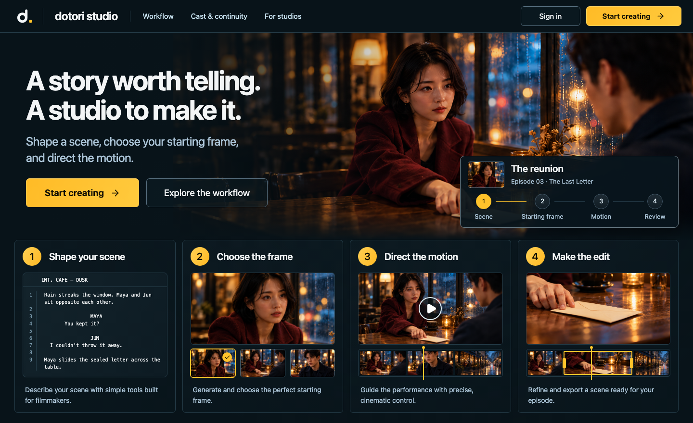
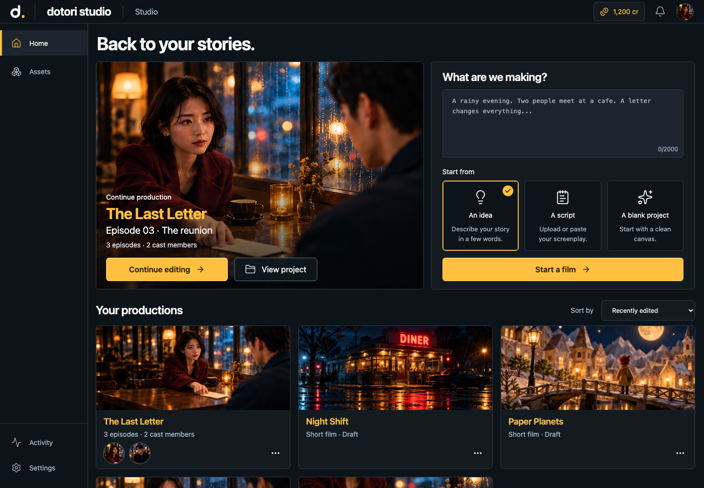
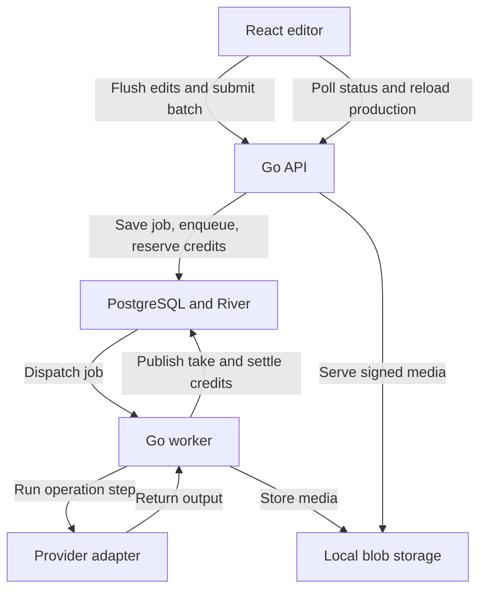

# dotori studio

dotori studio is a short-film production workspace. Start with an idea, a script excerpt, or a blank project. Build an episode scene by scene, reuse cast and visual references, generate candidate shots and takes, then assemble and export a cut. The workflow gives first-time filmmakers a guided path through production and gives experienced users control over shot direction, references, take selection, and timing.



*Public homepage.*



*Projects home in the development demo, populated with sample productions.*

## Run the demo

The demo uses browser-local state and simulated generation. It runs without Go, PostgreSQL, Clerk credentials, or paid provider calls.

```sh
cd frontend
npm ci
VITE_AUTH_BYPASS=true VITE_HOME_WORKFLOW=demo npm run dev -- --port 5175 --strictPort
```

Use a Node version supported by the repository's Vite version. The [frontend setup guide](frontend/README.md#run) records Node 26 as a verified runtime.

Open [the public homepage](http://127.0.0.1:5175/) or go straight to [Projects](http://127.0.0.1:5175/projects). Open **The Last Letter**, pick an episode, and follow **Scene plan → Shots → Takes → Final video**. The sample assets let you inspect continuity and cut editing without waiting on an external model. For a new production, the demo's idea and script flows create a local draft. The [demo asset notes](frontend/public/media/director-desk/README.md) document the sample imagery.

## Production workflow

| Stage | What you can do | Rules implemented in the app |
| --- | --- | --- |
| Start a film | Submit an idea or script excerpt, or create a blank project | Connected idea and script submissions return an interpretation proposal or clarification. A blank project creates an owned server record. |
| Scene plan | Write scenes, define shots, and attach cast, locations, props, and other references | Preview and edit suggested shots before applying them. Suggestions become stale if their source scene changes. |
| Shots | Generate frame candidates and choose an available frame for a shot | Generation records a snapshot of the shot and its reference versions. A new candidate leaves the chosen frame in place until selection changes. |
| Takes | Generate and review video candidates, then choose a take | Candidates are scoped to the shot. An older result can still be reviewed, and the editor compares its revision to the current shot revision. |
| Final video | Arrange takes, split or trim clips, add audio tracks, and render | The cut stores take references and edit ranges. Rendering consumes a snapshot of the cut, mixes audio, and can burn in dialogue captions. |

Projects contain episodes, episodes contain scenes, and scenes contain ordered shots. Takes link to assets and keep their producing job and generation inputs. Choosing a take updates an editorial pointer. Edits to the cut can reuse the same source asset across multiple clips. Characters, places, and props have reusable library records. A production can keep a snapshot of a reference so later library changes do not rewrite past shots. See the [editorial commands](frontend/src/domain/produce.ts), [cut model](frontend/src/domain/cut.ts), and [production save rules](server/internal/production/service.go).

### Credits and providers

Connected image generation and editing reserve **8 credits per result**. Video reserves **24 credits per result**. Interpretation and prompt enhancement are free in the application ledger. Shot requests can submit **one to four candidates**. The server reserves credits for the batch in one transaction and rejects the entire batch when the wallet cannot fund it. Successful publication captures the reservation. Terminal failure or stopped-job reconciliation releases it. These are product credit settings. Provider charges are tracked separately where the adapter supplies usage. [Wallet rules](server/internal/billing/wallet.go) · [Batch submission](server/internal/production/generation.go) · [Job reconciliation](server/internal/engine/reconcile.go)

| Capability | Current implementation |
| --- | --- |
| Home interpretation and prompt enhancement | Deterministic fake providers. Home displays the proposed action without executing it. |
| Image generation and editing | Fake provider by default. The optional OpenAI image adapter sends text-only or reference-conditioned requests and publishes PNG assets. |
| Shot video | The connected adapter returns a sample MP4 and accepts text input. It rejects frame and reference conditioning. The local demo simulates the image-first workflow. |
| Checkout | Disabled by default. The development/test provider simulates payment events and updates the server wallet. Real money collection is outside the current implementation. |
| Final video | The browser uses Canvas, Web Audio, and MediaRecorder to encode a cut as MP4 or WebM, depending on codec support. Connected export uploads the render as owned media. |

[Provider wiring](server/internal/app/providers.go) · [Image adapter](server/internal/providers/openai/image.go) · [Fake checkout](server/internal/billing/provider.go) · [Browser renderer](frontend/src/services/cut-renderer.ts)

## Full-stack architecture

| Layer | Stack and responsibility |
| --- | --- |
| Browser | React, TypeScript, Vite, and React Router render the studio. Zustand holds editable state and undo history. TanStack Query caches account-scoped API reads. Zod validates API responses and stored state. |
| API | Go `net/http` exposes JSON endpoints for production, assets, requests, generation jobs, and billing. Clerk bearer tokens resolve to internal user IDs used for ownership checks. |
| Data and queue | PostgreSQL stores editorial records, revision history, wallets, jobs, attempts, and artifact metadata. River schedules work through the same database using pgx. |
| Workers and media | A Go worker dispatches registered provider operations. Media bytes live in a local blob directory. The API issues expiring signed links for browser playback. |
| Export | The browser combines selected media, cut timings, audio, and captions. Connected mode uploads the encoded output and saves the export record. |

### From Generate to a candidate take



1. The editor flushes pending saves and submits a shot snapshot, reference IDs, and an idempotency key. The API checks the project and shot ownership and validates the operation input. [Frontend submission](frontend/src/services/shot-generation.ts) · [API routes](server/internal/httpapi/production.go)
2. The server stores the generation batch, logical job records, River tasks, and credit reservations in one transaction. Replaying a key with the same batch returns the existing jobs. Reusing it with changed input returns a conflict. [Batch and snapshot logic](server/internal/production/generation.go) · [Job submission](server/internal/engine/jobs.go)
3. The worker claims a job lease, runs a step outside the claim transaction, and checkpoints progress before waiting or continuing. Lease checks prevent stale executions from writing results. In the completion transaction, the worker publishes artifact and asset metadata, adds an unapproved take, captures credits, and completes the River task. [Worker](server/internal/engine/worker.go) · [Take publication](server/internal/production/generation.go)
4. A shared browser observer coalesces status checks by job ID and backs off on temporary failures. The editor reloads production after a terminal job update and requests a signed link for the asset. [Job observer](frontend/src/services/job-observer.ts) · [Signed downloads](server/internal/httpapi/download.go)

### Saving, recovery, and ownership

- **Autosave and conflicts.** The browser projects editorial state into a production document and sends the current server revision with each save. The server updates related records and appends a revision snapshot transactionally. A revision conflict leaves pending edits in the browser. A background refresh also defers applying data while local changes are pending. [Browser sync](frontend/src/services/production-sync.ts) · [Server save](server/internal/production/service.go)
- **Failure recovery.** River retries retryable steps from the last checkpoint. Startup and periodic reconciliation close jobs whose queue entries stopped before a result was saved. The OpenAI image adapter keeps a private response receipt and only allows a fresh provider call for an initial submission or confirmed, bounded rate-limit retry. An ambiguous response without a receipt surfaces as a job error. [Queue setup](server/internal/platform/queue/queue.go) · [Provider receipts](server/internal/providers/openai/image.go) · [Provider call claims](server/internal/providers/openai/calls.go)
- **Account and media isolation.** The API derives the owner from verified Clerk claims. File lookup checks the owner, and signed links bind a file and owner to an expiry. The browser clears account caches and aborts pending work when the account changes. The production document strips signed media URLs before saving. [API authentication](server/internal/httpapi/auth.go) · [Account cache](frontend/src/services/server-data.tsx) · [Document projection](frontend/src/services/production-document.ts)

### API entry points

| Endpoint | Purpose |
| --- | --- |
| `GET /api/v1/me` | Resolve the signed-in session to an internal account |
| `GET /api/v1/projects`, `POST /api/v1/projects` | Browse owned projects or create a blank project |
| `POST /api/v1/requests` | Persist a prompt and schedule interpretation |
| `GET`, `PUT /api/v1/projects/{projectId}/production` | Read and revision-save the editorial document |
| `POST /api/v1/projects/{projectId}/shots/{shotId}/generations` | Submit a shot candidate batch |
| `GET /api/v1/jobs/{jobId}` | Read job state, attempts, and result artifacts |
| `POST /api/v1/assets/uploads`, `GET /api/v1/asset-files/{fileId}/url` | Upload media and obtain a signed file link |
| `GET /api/v1/billing/wallet` | Read available and reserved credits |

See the [backend guide](server/README.md#connected-studio-persistence) and [route registration](server/internal/httpapi/server.go) for related character, reference, billing, and health endpoints.

## Run the connected stack

You need Go 1.27.1, Node/npm, PostgreSQL 17 or Docker Compose, and a Clerk application with an allowed local frontend origin.

1. From the repository root, start the database and prepare the server environment.

   ```sh
   cd server
   docker compose up -d --wait
   cp -n .env.example .env
   ```

   In `server/.env`, configure `CLERK_SECRET_KEY`, `CLERK_ISSUER`, and `CLERK_AUTHORIZED_PARTIES` together. Use the issuer origin and allow `http://127.0.0.1:5173` for the frontend command below. The example database URL points to the local Compose service. With an existing PostgreSQL instance, skip Compose and set `DATABASE_URL` to that instance. Set a stable `MEDIA_SIGNING_KEY` if download links need to survive backend restarts.

2. Load the server environment, apply migrations, and start Go in the same terminal.

   ```sh
   set -a
   . ./.env
   set +a
   go run ./cmd/studio migrate
   go run ./cmd/studio
   ```

3. In a second terminal, from the repository root, prepare the frontend environment.

   ```sh
   cd frontend
   npm ci
   cp -n .env.example .env.local
   ```

   Set `VITE_CLERK_PUBLISHABLE_KEY` from the same Clerk application and keep `VITE_AUTH_BYPASS=false` and `VITE_HOME_WORKFLOW=api`. Start the frontend with those settings.

   ```sh
   npm run dev -- --port 5173 --strictPort
   ```

   Open [Projects](http://127.0.0.1:5173/projects) and sign in. Vite proxies `/api` to Go on port `8080`. The browser sends the Clerk session token with API requests.

New connected accounts start with an empty credit wallet. To exercise generation with local fake checkout, use a development database and set `APP_ENV=development`, `PAYMENT_PROVIDER=fake`, and `PAYMENT_FAKE_SECRET` in the server environment. Restart Go, open **Recharge**, and simulate a paid event. Image generation defaults to the fake provider. To opt into the OpenAI adapter, set `IMAGE_PROVIDER=openai` and `OPENAI_API_KEY` in the server environment. [Billing setup](server/README.md#fake-payments-and-credits) · [Image provider setup](server/README.md#openai-sunburst-images)

For hosting, build the frontend with `npm run build` and the connected Clerk configuration. Serve `frontend/dist` with an SPA fallback and route `/api` to Go before applying that fallback. Persist the PostgreSQL database and the Go blob directory. The checkout includes a PostgreSQL Compose service and local run commands. [Frontend hosting notes](frontend/README.md#installable-app-pwa) · [Backend setup](server/README.md#run-locally)

## Tests

```sh
(cd frontend && npm test)
(cd frontend && npm run typecheck)
(cd server && make test)
(cd server && make check)
```

Run `make integration` from `server/` with `TEST_DATABASE_URL` pointing to a local PostgreSQL instance whose test role can create isolated databases. The integration suite uses fake providers for shot generation and billing. [Test setup](server/README.md#verification) · [Database harness](server/internal/engine/integration_test.go)

- **Frontend regressions** cover the scene-to-cut flow, stale autosave responses, revision conflicts, and shared polling. [Editor](frontend/src/test/produce-workspace.test.tsx) · [Persistence](frontend/src/test/production-persistence.test.ts) · [Polling](frontend/src/test/job-observer.test.ts)
- **Backend integration tests** cover production ownership, reference snapshots, candidate delivery, concurrent idempotency, and atomic credit reservations. [Production](server/internal/engine/production_integration_test.go) · [Worker](server/internal/engine/integration_test.go) · [Billing](server/internal/engine/billing_integration_test.go)

## Repository map

| Path | Contents |
| --- | --- |
| [`frontend/src/studio/`](frontend/src/studio/) | Projects home, studio shell, episode production views, and shared UI |
| [`frontend/src/domain/`](frontend/src/domain/) | Editorial models, validation, generation inputs, and cut operations |
| [`frontend/src/services/`](frontend/src/services/) | Server-state integration, autosave, job observation, and export |
| [`server/internal/httpapi/`](server/internal/httpapi/) | HTTP handlers and authentication |
| [`server/internal/production/`](server/internal/production/) | Production persistence, shot submissions, and take publication |
| [`server/internal/engine/`](server/internal/engine/) | Job registry, worker lifecycle, retry, and reconciliation |
| [`server/internal/platform/db/migrations/`](server/internal/platform/db/migrations/) | PostgreSQL schema and migrations |
